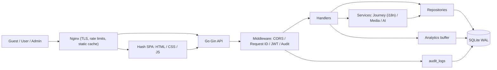

# 100 Journeys | 桃源百旅

[](https://github.com/LibertychaserUS/100-journeys/actions/workflows/ci.yml)
[](https://52-203-52-72.sslip.io/)
[](docs/testing/TDD-spec.md)

中文：**桃源百旅** 是一个故事化的旅行灵感产品。用户不是从地图选目的地，而是从一种心情、一个 MBTI 人格或一类幻想世界出发，读一段带有临时身份、任务和线索的“旅行剧本”，再用虚拟币领取它。

English: **100 Journeys** is a story-driven travel discovery app. Instead of choosing a destination from a map, you start from a mood, an MBTI personality or a kind of fantasy world, read a short "travel script" with a role, a mission and clues, and claim it with a virtual coin wallet.

Full-stack: Go + Gin API, pure-Go SQLite, a vanilla JS single-page app, JWT auth, a simulated wallet and checkout, an admin dashboard, Playwright and k6 test suites, and CI/CD to AWS.

---

## Live demo | 在线演示

| | |
|---|---|
| App | <https://52-203-52-72.sslip.io/> |
| Sign up | <https://52-203-52-72.sslip.io/#/register> (email + a simple math captcha, no verification email) |
| Admin dashboard | <https://52-203-52-72.sslip.io/#/admin-login> (admin accounts are created server-side) |

Every push to `main` runs CI and, when it is green, deploys to the demo. The app follows your OS light/dark preference and browser language (中文 / English); both can be switched in the header.


More screenshots, before and after the 2026-10 redesign: [docs/design/redesign-2026-10](docs/design/redesign-2026-10/README.md)

---

## Features | 功能

- **按心情、人格、幻想类型探索 | Discover by mood, MBTI or fantasy type**: search, mood shortcuts, fantasy-type facets and a filter panel (MBTI, adventure level, tags, visual style). Filters live in the URL, so a filtered view can be shared.
- **找到你的入口 | Find your entrance**: pick one of sixteen type cards or walk six small scenes with the guide (resumable); land in your own space with the entrances that open for you. Guest progress moves into the account on sign-up.
- **桃源入口 | Authored entrances**: journeys are bilingual JSON files (`internal/content/entrances/`) with a role, a mission, chapters, a fork whose choice you keep, an ending and a sourced "what is real, what is not" note; a test lint keeps the copy showing rather than telling. Contract: [docs/content/SCHEMA.md](docs/content/SCHEMA.md).
- **旅行剧本 | Travel scripts**: every journey still has a role and practical clues (gear, risk), plus a booking "ticket".
- **画一个自己的入口 | Draw your own entrance**: piece a ticket together from paper slips (a place, an hour, a season, how long you stay, a small ritual, what you take home) by tapping, dragging or with the keyboard. The ticket's sentence comes from per-language templates, blanks can be filled in later, guests keep tickets on the device until they sign in, and a kept ticket can be shared by a read-only link (`#/compose`).
- **中英双语 | Bilingual**: UI strings in zh/en catalogs; journey content comes from the API in either language (`?lang=en`), and English searches match English copy.
- **收藏与旅行人格 | Saved journeys and travel personality**: save journeys and your type to your account; fork choices are kept per journey.
- **模拟交易 | Simulated commerce**: tiered top-ups with a real bonus, in-page checkout with a points discount, a shortfall flow that tops up and returns you to the order, and a full ledger.
- **小旅 · 灯灵 | Lumi, the guide**: an SVG lantern sprite that condenses into one of sixteen forms when your type is found. With `DEEPSEEK_API_KEY` set, free-text questions are answered by DeepSeek, grounded in the journey catalogue (only real journeys can be recommended, the type is never named back to you); without a key, on timeout (8 s), error or overload, the rule-based guide answers in zh/en.
- **后台 | Admin dashboard**: core-flow funnel by anonymous visitor, live metrics, most clicked and best-selling journeys, MBTI and gender distributions, audit counts, CSV export.
- **两套主题都可读 | Accessible in both themes**: semantic colour tokens, WCAG AA contrast checked by axe in dark and light, keyboard navigation, skip link, `prefers-reduced-motion`.

---

## Tech stack | 技术栈

| Layer | Technology |
|---|---|
| Backend | Go + Gin, pure Go (no CGO) |
| Database | SQLite via `modernc.org/sqlite`, WAL mode, single-writer connection with busy retry |
| Frontend | Vanilla HTML / CSS / JS hash SPA, no framework; self-hosted story serif subsets (Noto Serif SC, Newsreader, OFL; see [FONTS.md](docs/content/FONTS.md)) |
| Auth | JWT + bcrypt + math captcha; public sign-up cannot create admins |
| Analytics | Buffered, droppable event queue for non-critical events; funnel counted by an anonymous visitor id |
| AI guide | DeepSeek chat API (OpenAI-compatible) behind a timeout, token cap and concurrency limit, with a rule-based fallback; key from the environment only (AWS Secrets Manager in production) |
| Audit | Persistent `audit_logs` for API errors, panics and frontend errors |
| Media | Local static files, CDN-ready through `CDN_BASE_URL`; CSS/JS are fingerprinted (`?v=`) so long-lived caching is safe |
| Tests | Go unit/integration, Go stress, k6, Playwright (desktop + mobile, axe) |
| Delivery | GitHub Actions CI/CD to AWS Lightsail (Nginx + systemd) |

### Database access

The project uses `database/sql` with hand-written parameterised SQL in a repository layer instead of an ORM, so `db/schema.sql`, the queries and the tests stay directly auditable.

- Orders, payments, top-ups and the ledger are synchronous SQL transactions and never go through the analytics buffer.
- `repository.NewDB` enables WAL, foreign keys and a busy timeout, and limits the pool to one connection; `retryBusy` retries short SQLite lock contention.
- Journey copy lives in `journeys` (Chinese) with English in `journey_translations`; seed data upserts both on every start, so existing databases pick up content changes.

---

## Architecture | 架构



Entity-relationship diagram (generated from `db/schema.sql`): [docs/generated/database-er.mmd](docs/generated/database-er.mmd)

---

## API | 接口

JSON responses use one envelope: `{ data, error, total?, page?, limit? }`. The CSV export is the only exception.

| Method | Path | Auth | Purpose |
|---|---|---|---|
| `GET` | `/api/journeys` | Public | Search, filter and paginate journeys (`lang=zh` or `en`) |
| `GET` | `/api/journeys/:slug` | Public | Journey detail |
| `GET` | `/api/tags`, `/api/mbti` | Public | Filter taxonomies |
| `POST` | `/api/auth/register`, `/api/auth/login` | Public | Captcha-protected auth |
| `GET` | `/api/auth/me` | JWT | Current user |
| `GET` `PUT` `DELETE` | `/api/auth/saved[/:slug]` | JWT | Saved journeys |
| `PUT` | `/api/auth/mbti` | JWT | Save travel personality |
| `GET` | `/api/compose/fragments`, `/api/compositions/:code` | Public | Compose game slips; read-only shared ticket |
| `GET` `POST` `DELETE` | `/api/auth/compositions[/:id]` | JWT | Kept tickets (POST is idempotent on the client id) |
| `POST` | `/api/orders`, `/api/orders/:id/pay` | JWT | Create and pay orders |
| `GET` | `/api/payments/tiers` | Public | Top-up tiers and bonuses |
| `POST` | `/api/payments/recharge` | JWT | Simulated top-up |
| `GET` | `/api/admin/stats`, `/api/admin/export` | Admin | Dashboard data and CSV/JSON export |

Full contract: [docs/schema/api-contract.md](docs/schema/api-contract.md) · generated route list: [docs/generated/api-routes.md](docs/generated/api-routes.md)

---

## Run locally | 本地运行

Requires Go 1.26+.

```bash
git clone https://github.com/LibertychaserUS/100-journeys.git
cd 100-journeys
scripts/deploy/local-one-click.sh
```

The script initialises SQLite with the journeys, demo users, admins, orders and dashboard data, picks free ports, and prints the URL and the local demo accounts. Stop it with `scripts/deploy/local-one-click.sh --stop`. Guide: [docs/ops/LOCAL_ONE_CLICK_GUIDE.md](docs/ops/LOCAL_ONE_CLICK_GUIDE.md)

Or run just the server (default port 8080, database `./data/app.db`):

```bash
go run ./cmd/server
```

Create or promote an admin account:

```bash
ADMIN_PASSWORD='<from your secret store>' go run ./cmd/admin-user \
  -db ./data/app.db -email '<admin-email>' -username '<admin-username>'
```

---

## Tests | 测试

```bash
go test ./...
go vet ./...
find web/js -name '*.js' -exec node --check {} \;
```

Playwright (desktop Chromium + Pixel 7, including axe WCAG 2.1 A/AA scans in both themes):

```bash
cd e2e
npm install
npx playwright install chromium
npx playwright test
```

Stress and load:

```bash
go test -tags stress ./tests/stress -run TestStress -count=1 -timeout=360s

scripts/nginx/render-local-config.sh 18080 18081
BASE_URL=http://127.0.0.1:18080 VUS=200 DURATION=30s k6 run tests/load/public-content-flow.k6.js
```

Results and profiles: [docs/ops/LOAD_TEST_RESULTS.md](docs/ops/LOAD_TEST_RESULTS.md) · test plan and IDs: [docs/testing/TDD-spec.md](docs/testing/TDD-spec.md)

---

## Deployment | 部署

Production runs on AWS Lightsail behind Nginx with HTTPS, a systemd service, a separate data disk and nightly SQLite backups. CI deploys `main` automatically after all checks pass. Runbook: [docs/ops/AWS_LIGHTSAIL_RUNBOOK.md](docs/ops/AWS_LIGHTSAIL_RUNBOOK.md) · recovery: [docs/ops/DISASTER_RECOVERY.md](docs/ops/DISASTER_RECOVERY.md)

GitHub Pages cannot host this app (it needs the Go API and SQLite).

---

## Documentation | 文档

| Document | Content |
|---|---|
| [docs/ui-components/DDD-spec.md](docs/ui-components/DDD-spec.md) | Design system, colour roles, components, page lifecycle |
| [docs/schema/SDD-spec.md](docs/schema/SDD-spec.md) | Requirements and data schema |
| [docs/schema/api-contract.md](docs/schema/api-contract.md) | API contract |
| [docs/testing/TDD-spec.md](docs/testing/TDD-spec.md) | Test plan and test case IDs |
| [docs/generated/](docs/generated/README.md) | Routes, ER diagram and sample data generated from code |
| [docs/ops/](docs/ops/) | Deployment, load testing and recovery |

Orders, coins and points are simulated: there are no real payments or bookings.
