# 2026-10 UI/UX redesign · 改版前后

“灯笼夜游 / Lantern Night”: the UI is night, and light only falls on what you can act on.
Design rules, tokens and contrast ratios: [`docs/ui-components/DDD-spec.md`](../../ui-components/DDD-spec.md).

Left: `main@7986657`. Right: this redesign. Same demo data, Chromium 1440×900 and 390×844.

| | Before | After |
|---|---|---|
| Home | 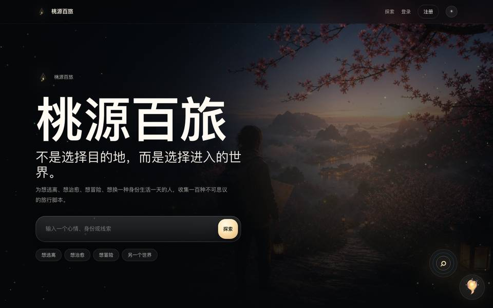 | 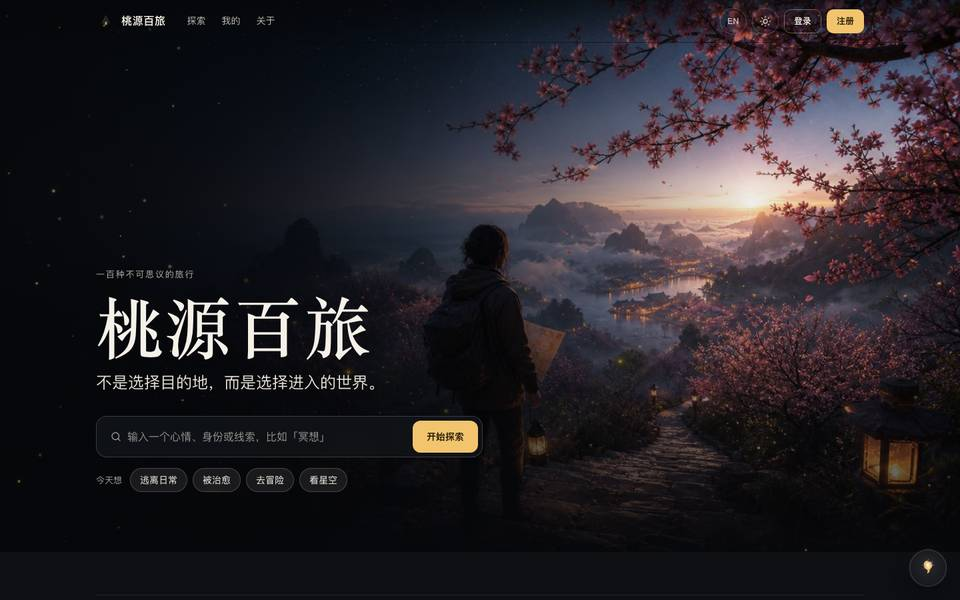 |
| Explore, after clicking a filter (before: stuck on skeletons) | 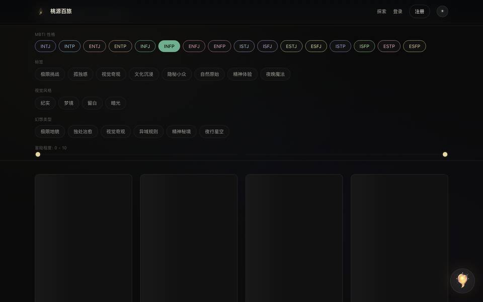 | 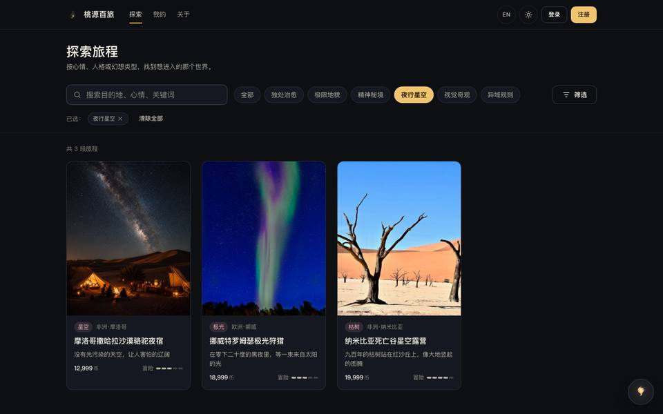 |
| Detail | 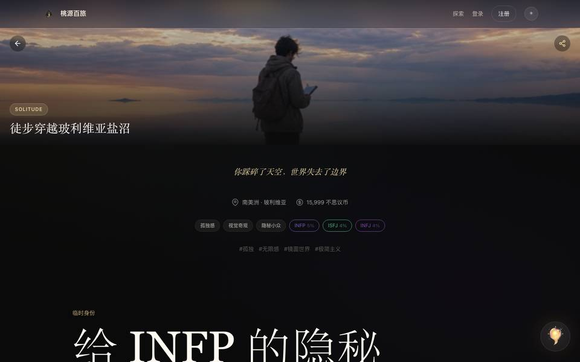 |  |
| Detail, light theme (before: white headline on white) | 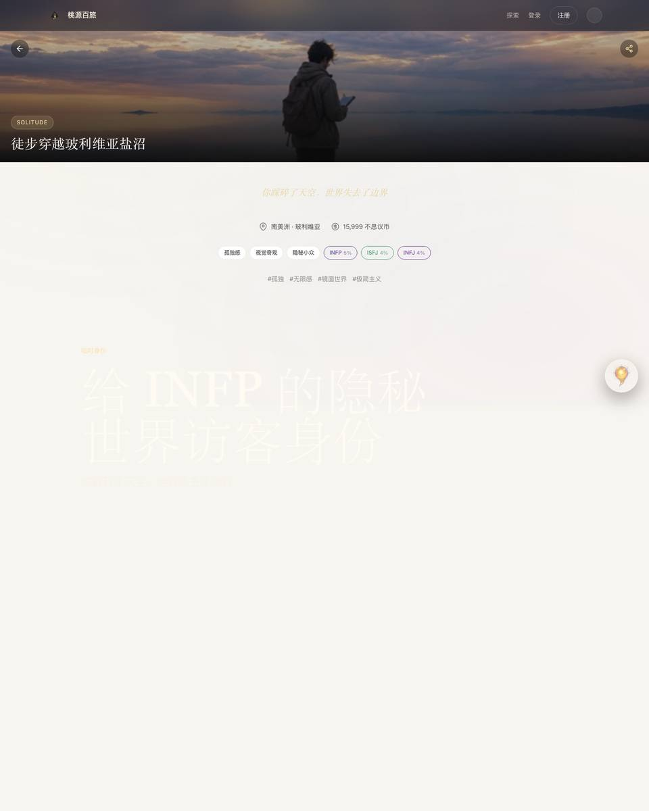 | 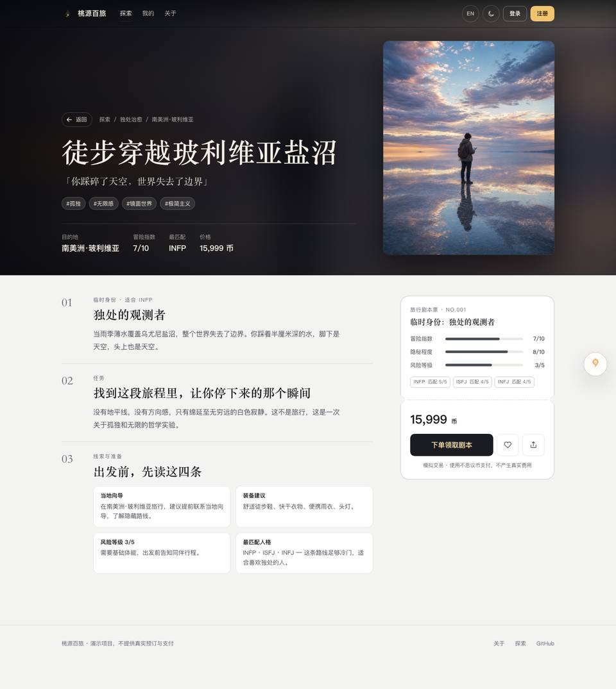 |
| Wrong password (before: “HTTP 401”) | 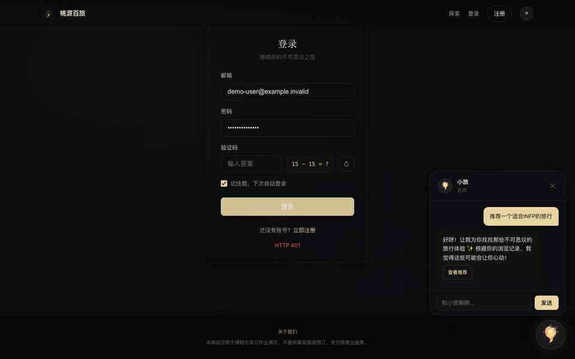 | 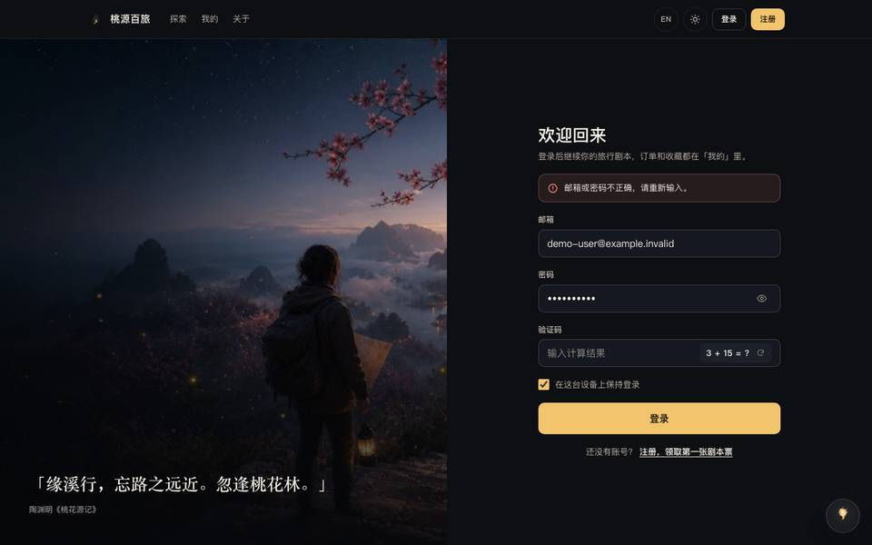 |
| My trips | 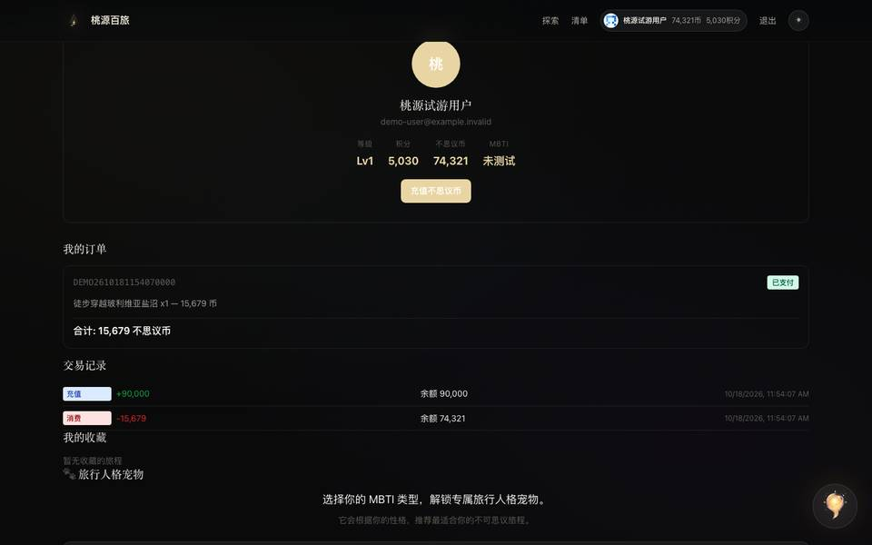 | 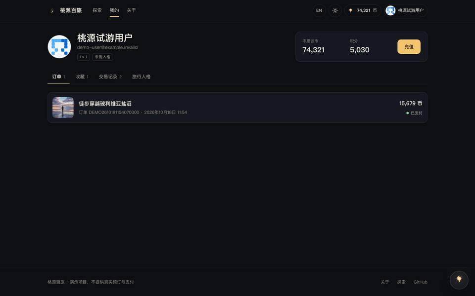 |

| Phone | Before | After |
|---|---|---|
| Home (before: no log-in entry) | 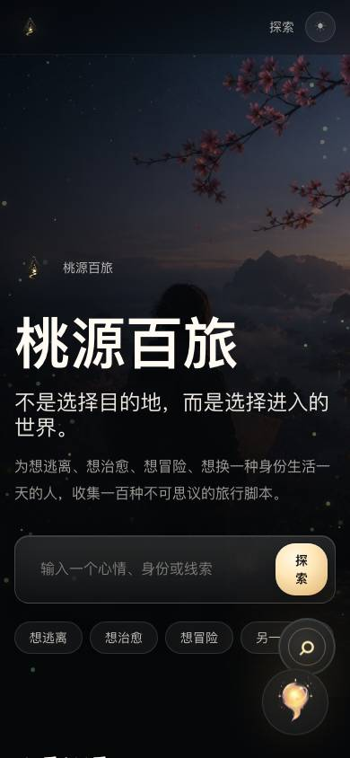 |  |
| Detail (after: booking bar) | 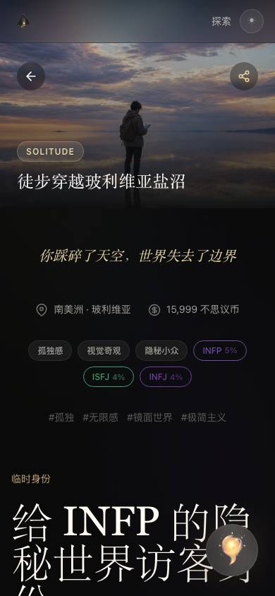 | 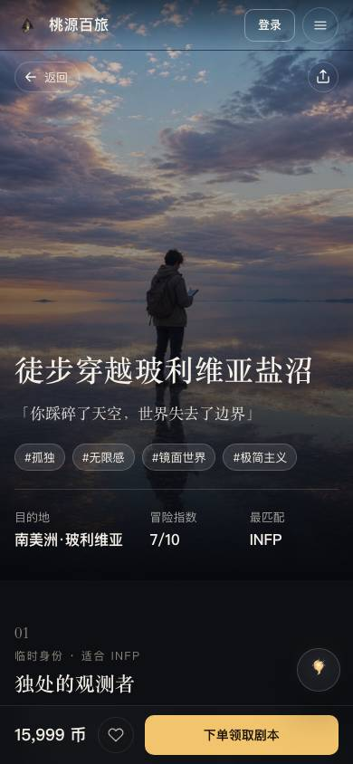 |
| Recharge (before: invisible amounts) | 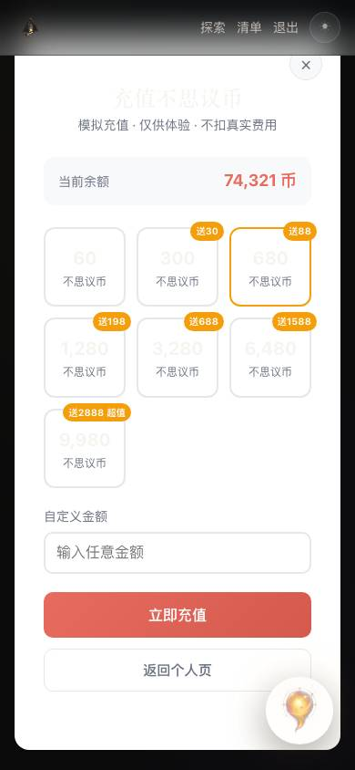 | 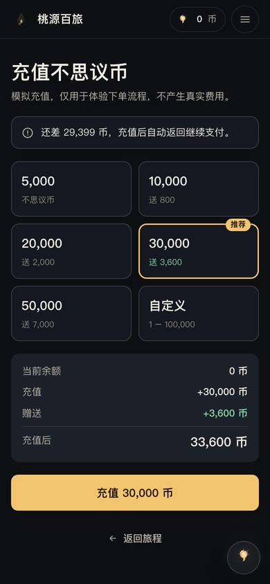 |
| Checkout with a shortfall | — | 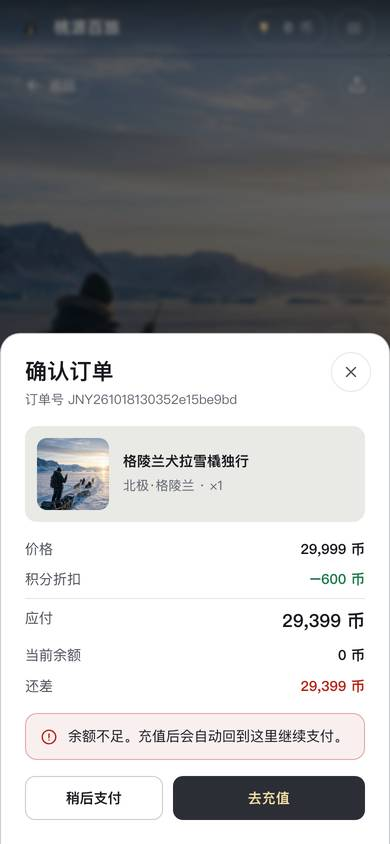 |

English UI and content:

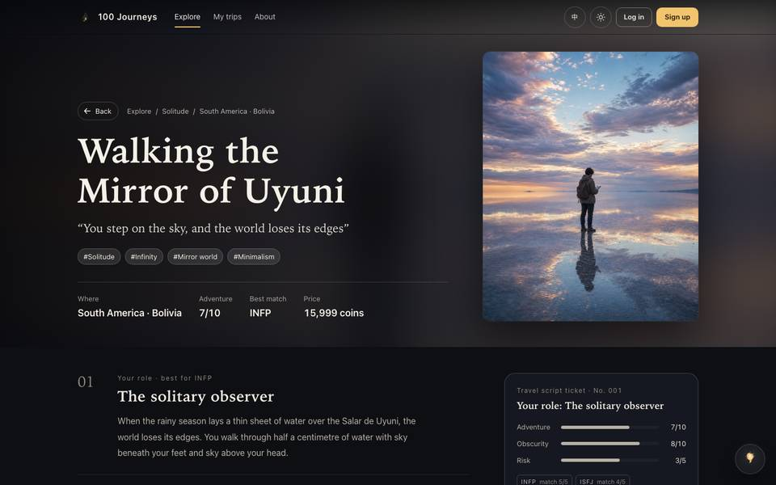

## Verification

- Playwright: 63 tests (desktop Chromium + Pixel 7), including axe WCAG 2.1 A/AA scans of 7 pages in both themes.
- axe on `main`: 102 violation nodes across home, explore, detail and login (dark + light). This branch: 0.
- `go test ./...`, the CI stress profile, `go vet`, `node --check` and the generated-docs check all pass.
