# 票路 · The Ticket Road (phase 1)

Travellers rub slips from the doors they walk, piece tickets from them, hang them at the Night
Station and by the doors they borrowed from, and light each other's tickets and the authored
journeys. Local dev data (seeded travellers, aged accounts), Chromium 1440×900 and 390×844,
reduced motion on for the captures. The night hall, the realm strips on the stubs and the carved
stone under the rubbing are the images in `web/assets/images/generated/road/`; by day the hall
stays painted in CSS.

| | Dark · 中文 | Light · English |
|---|---|---|
| The Night Station (`#/station`) | 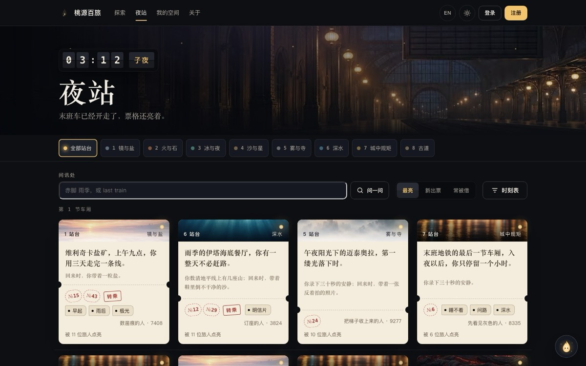 | 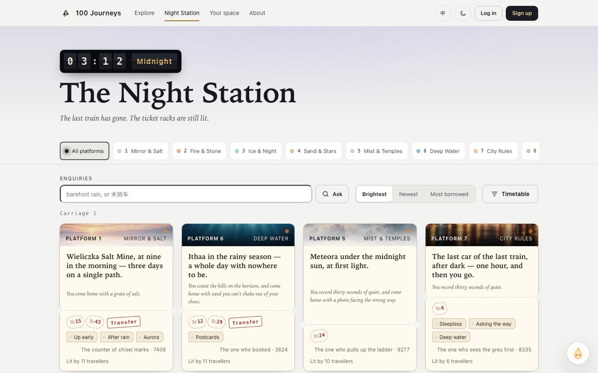 |
| Timetable: station clock, season ring, destination, luggage tags | 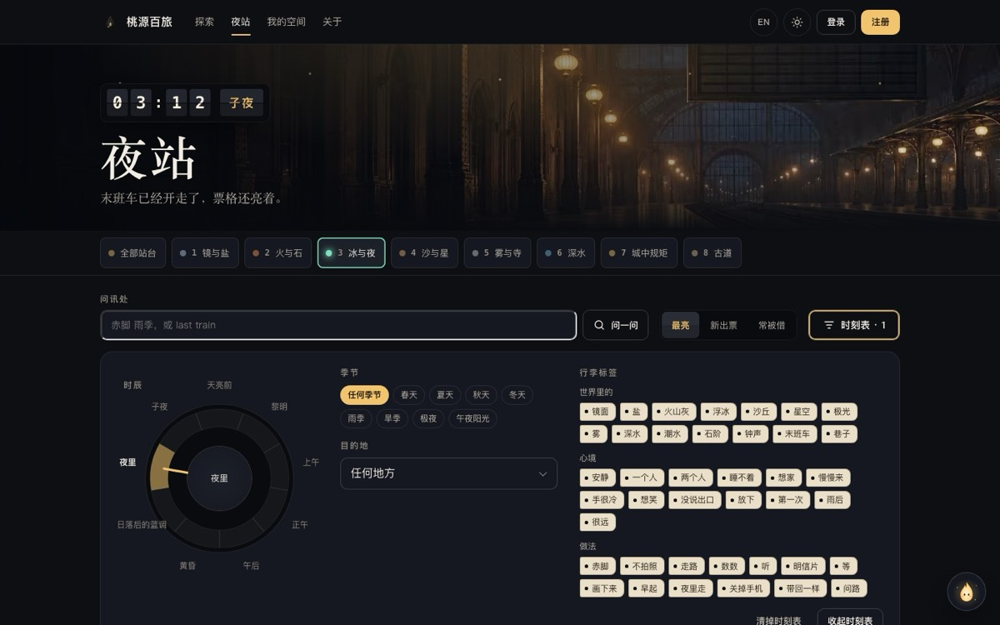 | 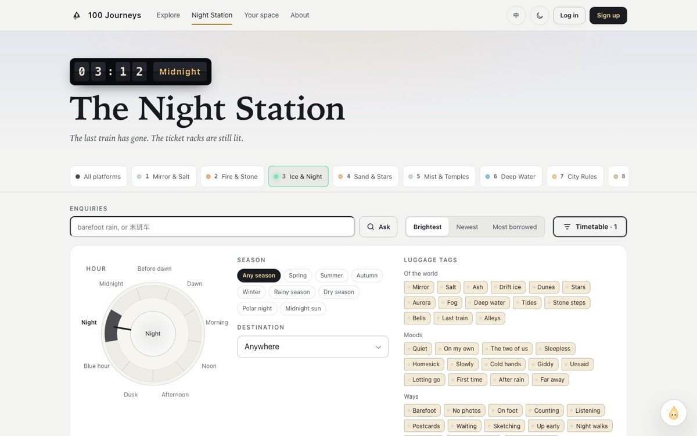 |
| A ticket’s back after lighting it (doors it borrowed from, the lantern) | 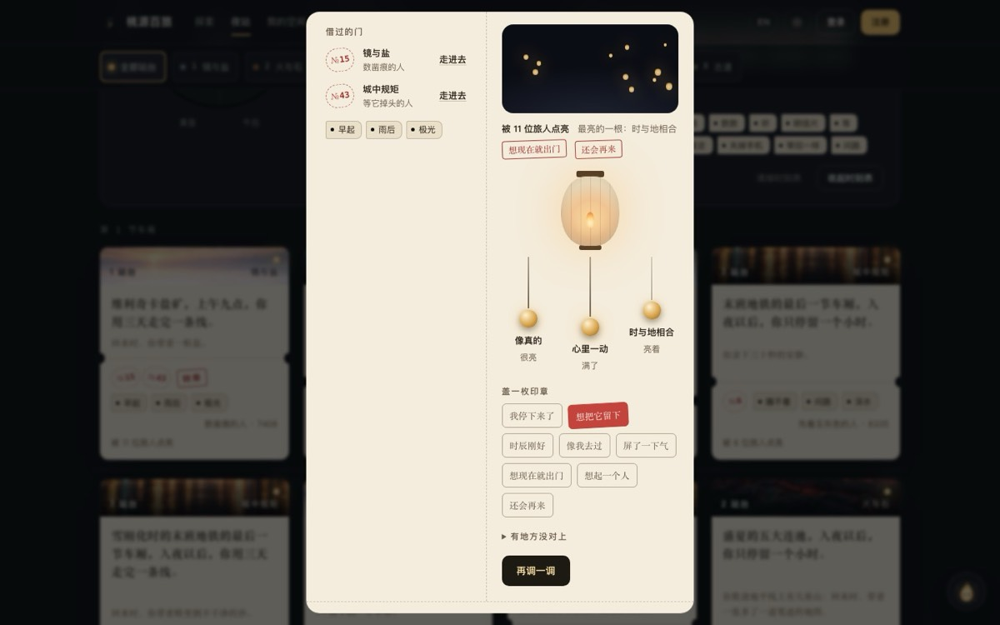 | 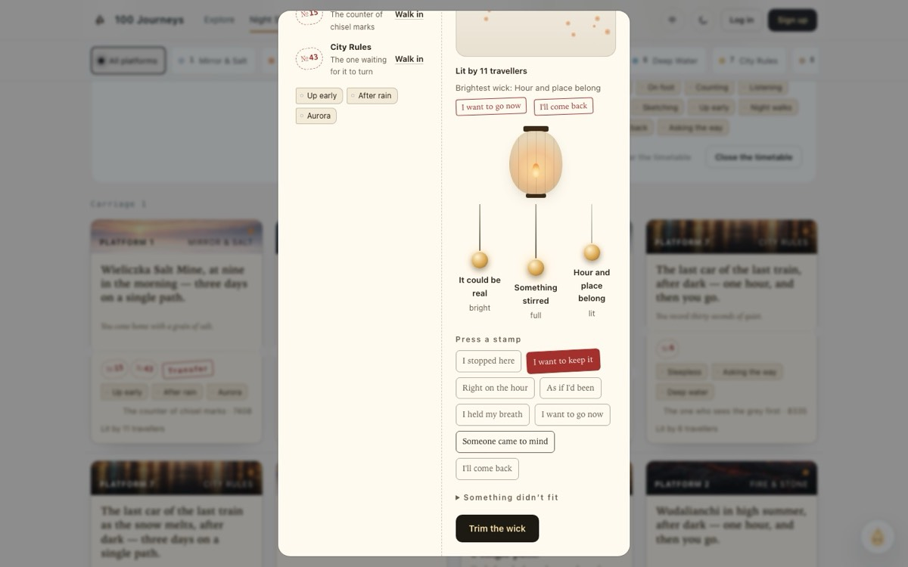 |
| The end of a door: the rubbing (lamp ash at night, charcoal by day) | 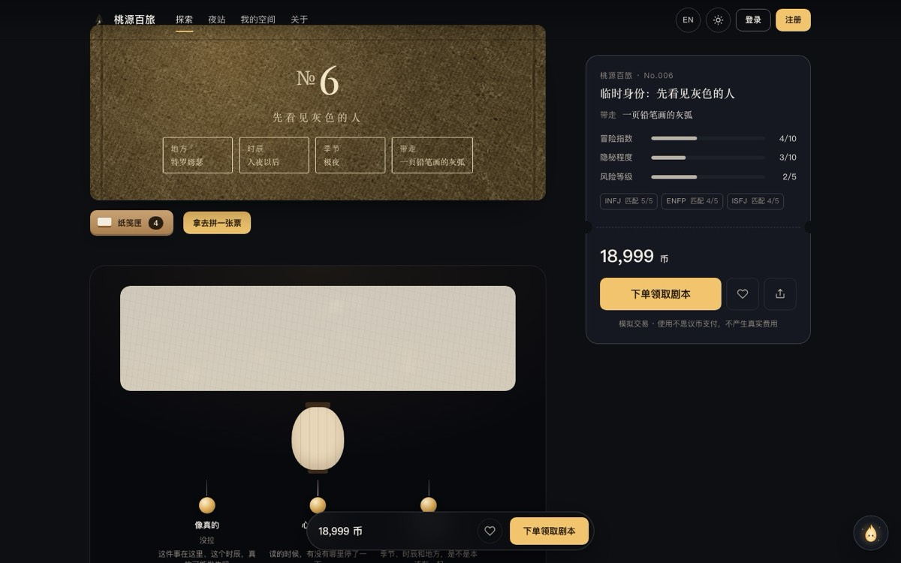 | 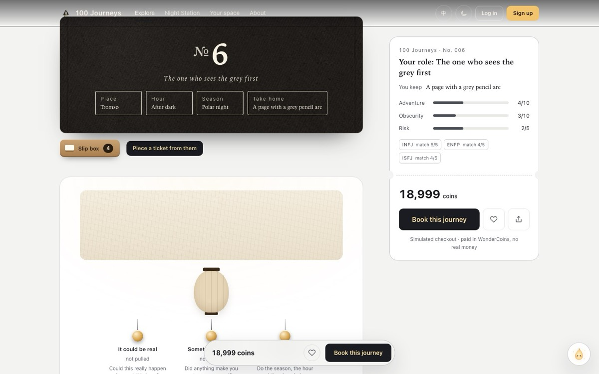 |
| The line by the door | 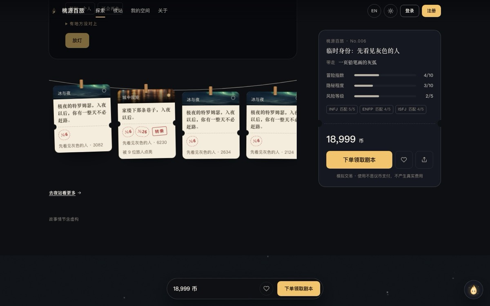 | 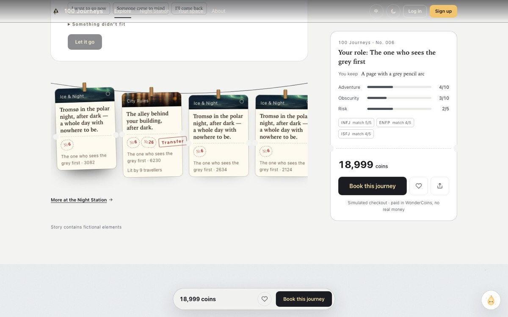 |
| Compose: held slips, outlines of doors not walked, postmarks | 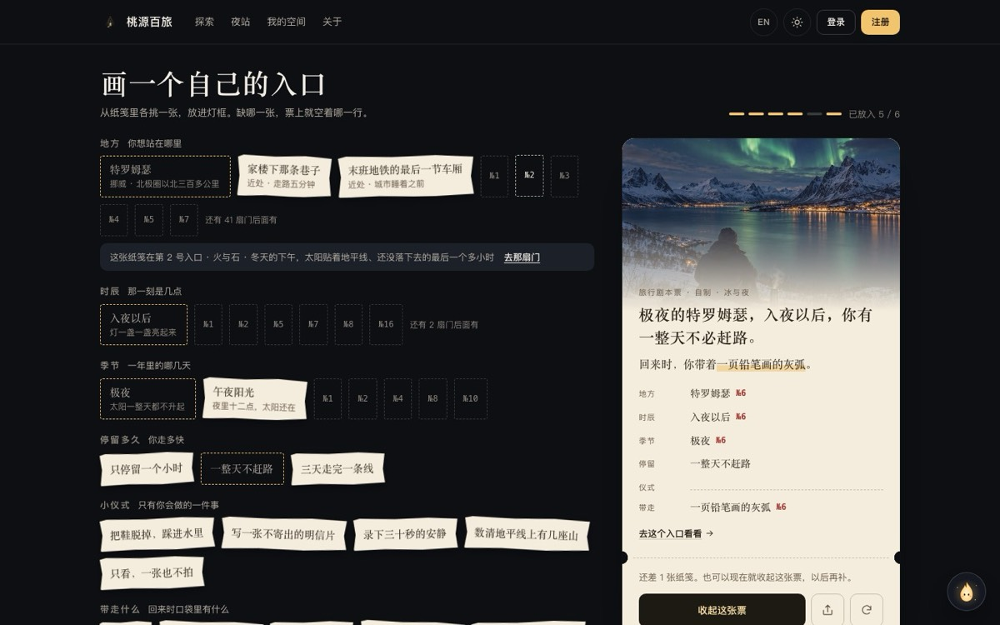 | 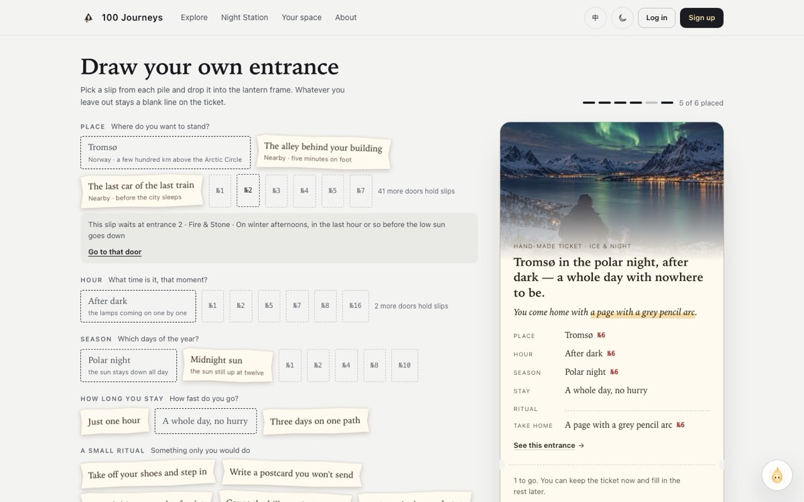 |
| Phone: the station | 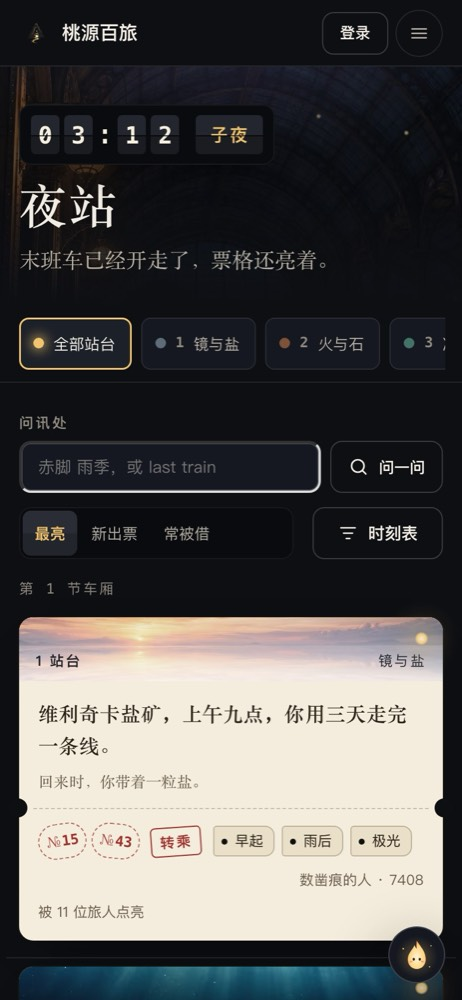 | 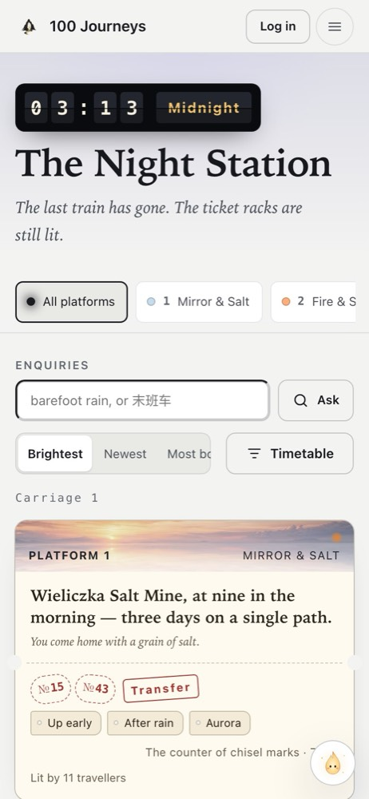 |
| Phone: a ticket's back | 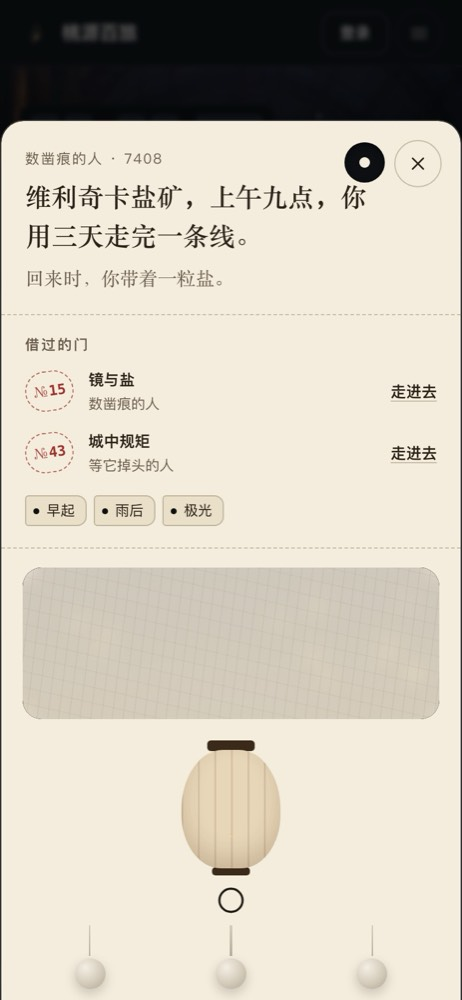 | 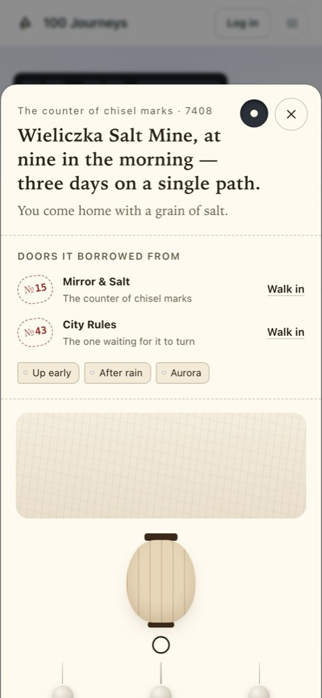 |

Also: [the rice paper before rubbing](rubbing-paper-dark-zh.jpg), [a journey's lantern under its paper shade](journey-lantern-light-en.jpg).
