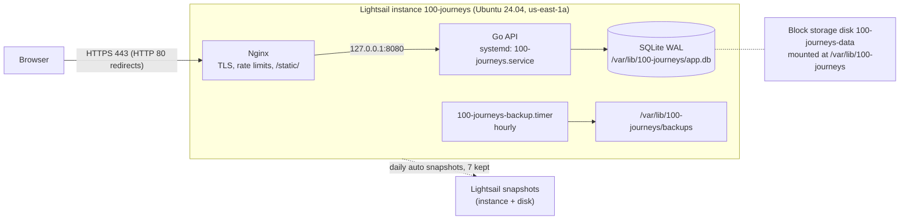

# AWS Lightsail Runbook

How 100 Journeys runs on AWS, and how to deploy, update, roll back, back up and restore it.
The Tencent Cloud deployment (`deploy/nginx.conf`, `scripts/deploy/sync-tencent.sh`) is separate and unaffected.

| | |
|---|---|
| Public URL | <https://52-203-52-72.sslip.io/> |
| Admin login | <https://52-203-52-72.sslip.io/#/admin-login> |
| Static IP | `52.203.52.72` |
| Region / AZ | `us-east-1` / `us-east-1a` |

Commands below use this shell helper (zsh and bash):

```bash
h() { ssh -i ~/.ssh/100-journeys-lightsail -o IdentitiesOnly=yes ubuntu@52.203.52.72 "$@"; }
```

## 1. Topology



SQLite needs a single writer on a persistent disk, so the app runs as one instance. App data lives on a
separate block-storage disk, so the instance can be rebuilt without moving data.

| Resource | Name | Notes |
|---|---|---|
| Instance | `100-journeys` | `micro_3_0`: 2 vCPU, 1 GB RAM, 40 GB SSD, 2 TB transfer, public IPv4 included. Daily auto snapshot 06:00 UTC |
| Static IP | `100-journeys-ip` | Free while attached |
| Disk | `100-journeys-data` | 8 GB ext4 (label `journeys-data`) at `/var/lib/100-journeys`. Daily auto snapshot 06:00 UTC |
| Key pair | `100-journeys-key` | Public half of `~/.ssh/100-journeys-lightsail`; the private key stays on the operator's machine |
| Firewall | instance ports | 22 from the operator IP /32 only; 80 and 443 from anywhere |
| Hostname | `<ip-with-dashes>.sslip.io` | Free wildcard DNS that resolves to the IP; Let's Encrypt certificate, auto-renewed by `certbot.timer` |
| Secret | `100-journeys/deepseek-api-key` (Secrets Manager, us-east-1) | DeepSeek API key, plain string. Synced to the server as `DEEPSEEK_API_KEY` by `deploy.sh` (section 9) |

Monthly cost (us-east-1 list prices): instance $7.00 + disk 8 GB × $0.10 = $0.80 + snapshots ≈ $0.05/GB-month
of stored, incremental data (≈ $0.25–1) + Secrets Manager $0.40 per secret (API calls $0.05 per 10,000; one
read per deploy). Total ≈ **$8.50–9.50/month**. Static IP, certificate and sslip.io are free.

**Billing.** On an AWS **Free plan** account these charges come out of Free Tier credits instead of a card.
The Free plan ends six months after sign-up or when the credits run out, whichever comes first; upgrade to the
Paid plan (Billing console) before then, or the account and this deployment are closed (AWS allows 90 days after
expiry to upgrade before deleting content). Check with `aws freetier get-account-plan-state`.

**Payments are virtual.** Recharge, orders and payments use the in-app virtual currency (不思议币). No payment
provider is connected and no real money or service is involved.

### Server layout

| Path | Contents |
|---|---|
| `/opt/100-journeys/releases/<UTC time>-<sha>/` | `bin/{server,admin-user,demo-data}`, `web/`, `db/`, `deploy/aws/`, `REVISION`. The newest 5 are kept |
| `/opt/100-journeys/current` | Symlink to the active release; the service's working directory |
| `/var/lib/100-journeys/` | `app.db` (+ `-wal`, `-shm`), `uploads/`, `backups/{hourly,daily,predeploy}/`, `quarantine/` |
| `/etc/100-journeys/100-journeys.env` | Service environment: random `JWT_SECRET`, and `DEEPSEEK_API_KEY` synced from Secrets Manager (root, 0600) |
| `/etc/100-journeys/site.env` | `SERVER_NAME` used to render Nginx |
| `/etc/100-journeys/credentials/accounts.env` | Generated owner-admin and demo-account passwords (root, 0600) |
| `/etc/nginx/sites-available/100-journeys` | Rendered from `deploy/aws/nginx/site-http(s).conf.tmpl` |

All server-side files come from `deploy/aws/` in the repo; `install-config.sh` re-installs them on every release activation.

## 2. Prerequisites (operator machine)

- AWS CLI v2 signed in to the account: `aws login`, then `aws sts get-caller-identity`
- Go (version from `go.mod`); binaries are cross-compiled locally, the server has no Go toolchain
- `rsync`, `ssh`, `python3`
- Node.js, for the Playwright suite only

## 3. First-time setup

```bash
# 1. Lightsail resources (idempotent; prints the static IP and sslip.io name)
scripts/deploy/aws/provision-lightsail.sh

# 2. First deploy: bootstraps the server (packages, swap, data disk, user, secrets), then activates the release
scripts/deploy/aws/deploy.sh <static-ip> <ip-with-dashes>.sslip.io

# 3. HTTPS (Let's Encrypt via webroot; no email registered), then Nginx switches to the HTTPS site
ssh -i ~/.ssh/100-journeys-lightsail ubuntu@<static-ip> sudo /opt/100-journeys/current/deploy/aws/server/enable-https.sh

# 4. Data: 50 demo users with orders/analytics, 3 demo admins, and the owner admin (cmd/admin-user).
#    Optional: ADMIN_EMAIL=you@example.com before the command (sudo ADMIN_EMAIL=... ...).
ssh -i ~/.ssh/100-journeys-lightsail ubuntu@<static-ip> sudo /opt/100-journeys/current/deploy/aws/server/init-data.sh

# 5. Verify
scripts/deploy/aws/smoke.py https://<server-name>
ssh -i ~/.ssh/100-journeys-lightsail ubuntu@<static-ip> sudo /opt/100-journeys/current/deploy/aws/server/check-admin-login.sh
```

Read the generated passwords (never commit or paste them anywhere public):

```bash
h sudo cat /etc/100-journeys/credentials/accounts.env
```

Admin login page: `https://<server-name>/#/admin-login`. Account emails and passwords are both in `accounts.env`.

## 4. CI/CD (GitHub Actions)

`.github/workflows/ci.yml` runs CI on every push and pull request: Go tests/vet, JS syntax, script syntax,
generated-docs check, local one-click and Nginx checks, stress and k6 smoke, and Playwright E2E. After **all** CI
jobs pass on a push to `main` (or a manual *Run workflow*), the `deploy` job:

1. assumes the IAM role `100-journeys-github-deploy` through GitHub OIDC (no long-lived AWS keys),
2. opens port 22 for the runner's IP only (`lightsail:OpenInstancePublicPorts`),
3. runs `scripts/deploy/aws/deploy.sh` (pre-deploy backup, health-checked switch with automatic rollback,
   DeepSeek key sync from Secrets Manager),
4. runs `smoke.py --read-only` against the public URL and switches back to the previous release if it fails,
5. always closes port 22 for the runner and deletes the key, even when an earlier step failed.

| Piece | Where | Notes |
|---|---|---|
| OIDC provider | IAM, `token.actions.githubusercontent.com` | audience `sts.amazonaws.com` |
| Role `100-journeys-github-deploy` | IAM | Trust: only `repo:LibertychaserUS/100-journeys:environment:production`. Permissions: `lightsail:Open/CloseInstancePublicPorts` on resources tagged `project=100-journeys`, `secretsmanager:GetSecretValue` on `100-journeys/deepseek-api-key` |
| Environment `production` | GitHub repo settings | Deployment branches: `main` only. Secrets `DEPLOY_SSH_KEY`, `AWS_ROLE_ARN`; variables `DEPLOY_HOST`, `SERVER_NAME`, `SSH_KNOWN_HOSTS` |
| Deploy key | `~ubuntu/.ssh/authorized_keys` on the server | Dedicated key, comment `100-journeys-github-actions`; the private half exists only in the environment secret (and the operator's `~/.ssh/100-journeys-ci`) |

Pull requests, including ones from forks, never reach the `deploy` job or the environment secrets.

Revoke CI access: delete the `100-journeys-github-actions` line from `authorized_keys` and the environment
secrets, or delete the role. Rotate the deploy key: generate a new key, append its public half on the server,
`gh secret set DEPLOY_SSH_KEY --env production < new_key`, then remove the old line.

If the server's host key changes (rebuilt instance), update `SSH_KNOWN_HOSTS`:
`gh variable set SSH_KNOWN_HOSTS --env production --body "$(ssh-keyscan -t ed25519,rsa,ecdsa <ip>)"`
(verify the fingerprint over the Lightsail browser console first). If the static IP changes, update `DEPLOY_HOST`
and `SERVER_NAME` as well.

## 5. Update (deploy a new version)

With CI/CD, merging to `main` deploys automatically. Manual deploy from the operator machine:

```bash
git switch main && git pull
scripts/deploy/aws/deploy.sh 52.203.52.72
scripts/deploy/aws/smoke.py https://52-203-52-72.sslip.io --read-only
```

`deploy.sh` builds the current commit for the server's architecture, uploads it to a new release directory
(hard-linking unchanged files from the current release), then runs `activate-release.sh`, which:

1. takes a `predeploy` backup of the database,
2. switches `current`, re-installs systemd/Nginx config from the release (`nginx -t` gated) and restarts the API,
3. polls `http://127.0.0.1:8080/api/health` for 20 s, and **automatically switches back** to the previous release if it fails.

Uncommitted changes are refused unless `ALLOW_DIRTY=1` (the release id then ends in `-dirty`).

The server applies `db/schema.sql` and `db/seed.sql` at startup, so schema changes must stay additive
(`CREATE TABLE IF NOT EXISTS`, new nullable columns) for rollbacks to keep working.

## 6. Rollback

```bash
# list releases (* = active)
h sudo /opt/100-journeys/current/deploy/aws/server/activate-release.sh --list
# back to the previous release
h sudo /opt/100-journeys/current/deploy/aws/server/activate-release.sh --previous
# or a specific one
h sudo /opt/100-journeys/current/deploy/aws/server/activate-release.sh <release-id>
```

If the bad release also changed data, restore the `predeploy` backup it took (section 8).

## 7. Backups

| Layer | Schedule | Retention | Where | Protects against |
|---|---|---|---|---|
| SQLite online backup (`backup.sh`) + `PRAGMA integrity_check` | hourly (`100-journeys-backup.timer`) | 48 hourly + 14 daily | `/var/lib/100-journeys/backups/{hourly,daily}` | bad writes, app bugs, accidental deletes |
| Pre-deploy backup | every activation, `init-data.sh --reset` | last 10 | `/var/lib/100-journeys/backups/predeploy` | a bad release |
| Lightsail auto snapshots of instance and data disk | daily 06:00 UTC | 7 days | AWS-managed, off the instance | disk/instance loss |

Useful commands:

```bash
h systemctl list-timers 100-journeys-backup.timer           # next/last run
h sudo systemctl start 100-journeys-backup.service          # backup now
h sudo ls -lh /var/lib/100-journeys/backups/hourly          # list (the directory is 0750, so sudo)
# copy the newest backup to this machine
h 'sudo install -m 644 "$(sudo find /var/lib/100-journeys/backups/hourly -name "app-*.sqlite.gz" | sort | tail -1)" /tmp/latest.sqlite.gz'
scp -i ~/.ssh/100-journeys-lightsail ubuntu@52.203.52.72:/tmp/latest.sqlite.gz . && h rm /tmp/latest.sqlite.gz
# Lightsail snapshots
aws lightsail get-auto-snapshots --resource-name 100-journeys
aws lightsail get-auto-snapshots --resource-name 100-journeys-data
```

Shell globs such as `backups/hourly/*` expand as `ubuntu` before `sudo` runs and match nothing; use
`sudo ls <dir>` or `sudo find` instead.

## 8. Restore

### 8.1 From an on-disk backup (most cases)

```bash
h sudo ls /var/lib/100-journeys/backups/hourly /var/lib/100-journeys/backups/daily /var/lib/100-journeys/backups/predeploy
h sudo /opt/100-journeys/current/deploy/aws/server/restore.sh /var/lib/100-journeys/backups/hourly/app-<stamp>.sqlite.gz
h sudo /opt/100-journeys/current/deploy/aws/server/restore.sh latest     # newest hourly backup
```

`restore.sh` verifies the backup with `integrity_check` before touching anything, stops the API, moves the
current `app.db*` to `/var/lib/100-journeys/quarantine/<stamp>/` (never deleted), installs the backup, starts the
API and waits for a healthy `/api/health`. Afterwards check orders and transactions in the admin dashboard, and
optionally run the consistency SQL in `docs/ops/DISASTER_RECOVERY.md` §4.

### 8.2 Data disk lost or corrupted

```bash
aws lightsail get-auto-snapshots --resource-name 100-journeys-data       # pick a date
aws lightsail create-disk-from-snapshot --disk-name 100-journeys-data-restored \
  --availability-zone us-east-1a --size-in-gb 8 \
  --source-disk-name 100-journeys-data --restore-date <YYYY-MM-DD>   # or --use-latest-restorable-auto-snapshot
h 'sudo systemctl stop 100-journeys-backup.timer 100-journeys.service && sudo umount /var/lib/100-journeys'
aws lightsail detach-disk --disk-name 100-journeys-data
aws lightsail attach-disk --disk-name 100-journeys-data-restored --instance-name 100-journeys --disk-path /dev/xvdf
h 'sudo mount /var/lib/100-journeys && sudo systemctl start 100-journeys.service 100-journeys-backup.timer'
```

The restored disk keeps the `journeys-data` label, so `/etc/fstab` mounts it unchanged. Then apply the newest
hourly backup from it if it is more recent than the snapshot (8.1).

### 8.3 Instance lost

1. Create a replacement from the instance auto snapshot (`aws lightsail create-instances-from-snapshot ...
   --source-instance-name 100-journeys --restore-date <date>`), or create a fresh one by deleting the old
   instance and rerunning `provision-lightsail.sh`.
2. Attach the data disk (or a disk restored from its snapshot) and the static IP (`attach-static-ip`), so the
   hostname and certificate stay valid.
3. On a fresh instance, run `deploy.sh <ip> <server-name>` (bootstrap mounts the existing disk without
   formatting it), then `enable-https.sh`. Do **not** run `init-data.sh` when the disk already has data.

## 9. Operations

**SSH from a new IP.** The firewall allows SSH only from the IP used at provisioning time:

```bash
aws lightsail put-instance-public-ports --instance-name 100-journeys --port-infos \
  "fromPort=22,toPort=22,protocol=tcp,cidrs=$(curl -s https://checkip.amazonaws.com)/32" \
  "fromPort=80,toPort=80,protocol=tcp,cidrs=0.0.0.0/0" \
  "fromPort=443,toPort=443,protocol=tcp,cidrs=0.0.0.0/0"
```

(`put-instance-public-ports` replaces all rules, so always pass all three.)

**Logs.** `h sudo journalctl -u 100-journeys -f`; Nginx: `/var/log/nginx/100-journeys.{access,error}.log`.

**Rate limits.** `/api/auth/` allows 5 requests/minute per IP (burst 10), `/api/` 10 r/s (burst 20). For an
operator test run (e.g. Playwright, which registers many users), exempt your IP temporarily and clear it afterwards:

```bash
h sudo /opt/100-journeys/current/deploy/aws/server/limit-exempt.sh add "$(curl -s https://checkip.amazonaws.com)/32"
h sudo /opt/100-journeys/current/deploy/aws/server/limit-exempt.sh clear
```

**Playwright against the deployed site.** E2E tests register users and place orders, so run them before
handing the demo over, then reset the data:

```bash
cd e2e && npm install && E2E_BASE_URL=https://52-203-52-72.sslip.io npx playwright test
h sudo /opt/100-journeys/current/deploy/aws/server/init-data.sh --reset   # keeps the same passwords
```

`smoke.py` without `--read-only` also leaves a `smoke-<time>@example.invalid` user and one order.

**Secrets (DeepSeek API key).** The key lives in AWS Secrets Manager as `100-journeys/deepseek-api-key`
(us-east-1, plain string). Lightsail instances have no IAM role, so the server never calls AWS: `deploy.sh`
reads the secret with the operator's `aws login` session and pipes it over SSH stdin to `set-env.sh`, which
writes `DEEPSEEK_API_KEY=...` into `/etc/100-journeys/100-journeys.env` (root, 0600). The value never appears
in process arguments, script output or git. If the secret does not exist, or the CLI is not signed in, the
server keeps its current value; `SKIP_SECRETS=1` skips the sync.

```bash
# create or rotate the key (prompted, so it stays out of shell history)
read -rs KEY && aws secretsmanager put-secret-value --secret-id 100-journeys/deepseek-api-key --secret-string "$KEY"; unset KEY
# (first time: aws secretsmanager create-secret --name 100-journeys/deepseek-api-key --secret-string "$KEY")
# push the new value without a redeploy
aws secretsmanager get-secret-value --secret-id 100-journeys/deepseek-api-key --query SecretString --output text |
  h sudo /opt/100-journeys/current/deploy/aws/server/set-env.sh DEEPSEEK_API_KEY && h sudo systemctl restart 100-journeys
# check it is set, without showing it
h sudo grep -c '^DEEPSEEK_API_KEY=' /etc/100-journeys/100-journeys.env
```

The app reads `DEEPSEEK_API_KEY` once a DeepSeek provider is merged; until then it uses `ai.NewMockAI()` and
ignores the variable. Removing the key: delete the line from the env file and restart the service.

**Certificates.** `systemctl list-timers certbot.timer`; dry run: `sudo certbot renew --dry-run`.

**Custom domain.** Point an A record at the static IP, then on the server:
set `SERVER_NAME=<domain>` in `/etc/100-journeys/site.env` and `CORS_ORIGINS=https://<domain>` in
`/etc/100-journeys/100-journeys.env`, run `enable-https.sh`, and `sudo systemctl restart 100-journeys`.

**Disk space.** `df -h / /var/lib/100-journeys`. Every API request is written to `audit_logs`, so the database
grows with traffic; backups are gzip-compressed and pruned automatically.

**OS updates.** Ubuntu `unattended-upgrades` installs security updates. Reboot when
`/var/run/reboot-required` exists: `sudo reboot` (the API, Nginx and timers start on boot).

**Owner admin password.** There is no password-change command yet; `cmd/admin-user` only creates an admin or
promotes an existing user. Rotating means `init-data.sh --reset` after removing `accounts.env`, which also
resets all data.

**AWS CLI identity.** Run these scripts as an IAM user or IAM Identity Center user limited to Lightsail (plus
`secretsmanager:GetSecretValue` on the app secret), not the account root user.

## 10. Teardown

Stops all charges. Snapshots are billed separately and must be deleted on their own.

```bash
aws lightsail detach-static-ip --static-ip-name 100-journeys-ip
aws lightsail release-static-ip --static-ip-name 100-journeys-ip
aws lightsail detach-disk --disk-name 100-journeys-data
aws lightsail delete-disk --disk-name 100-journeys-data --force-delete-add-ons
aws lightsail delete-instance --instance-name 100-journeys --force-delete-add-ons
aws lightsail delete-key-pair --key-pair-name 100-journeys-key
aws secretsmanager delete-secret --secret-id 100-journeys/deepseek-api-key --recovery-window-in-days 7
```

## 11. Deployment record (2026-10-18)

| Item | Value |
|---|---|
| Account / region | `<account-id>` / `us-east-1` (`us-east-1a`) |
| Resources | instance `100-journeys` (`micro_3_0`, Ubuntu 24.04.4, x86_64), static IP `100-journeys-ip` = `52.203.52.72`, disk `100-journeys-data` (8 GB, `/dev/nvme1n1`), key pair `100-journeys-key` |
| Firewall | 22 from the operator IP /32 (set at provisioning); 80, 443 from `0.0.0.0/0`; IPv4 only |
| Auto snapshots | instance and disk, daily 06:00 UTC, both `Enabled` |
| URL / certificate | <https://52-203-52-72.sslip.io/>, Let's Encrypt (YE2), expires 2027-01-16; `certbot renew --dry-run` succeeded |
| Active release | `h sudo /opt/100-journeys/current/deploy/aws/server/activate-release.sh --list`; `/opt/100-journeys/current/REVISION` holds the commit |
| DeepSeek key | synced from Secrets Manager on deploy; present in the env file and the running service environment (checked by count, value never shown) |
| Data | 50 demo users + 3 demo admins (`cmd/demo-data`), owner admin via `cmd/admin-user`; passwords only in `accounts.env` |
| Smoke test | `smoke.py` full run: 18/18 PASS over HTTPS (register, login, recharge, order, pay, transactions) |
| Admin login | `check-admin-login.sh`: login OK, `/api/admin/stats` HTTP 200 |
| Playwright | 29/29 passed against the HTTPS URL (operator IP rate-limit exemption during the run, cleared afterwards). The first run failed `create order from journey detail` because the test did not wait for `/pay` on a high-latency link; fixed in `e2e/tests/orders.spec.js` |
| Restore drill | hourly backup → write marker (smoke run) → `restore.sh latest`: users/orders/transactions 55/51/102 → 56/52/104 → 55/51/102, `integrity_check` ok, admin login OK |
| Reboot test | after `systemctl reboot`: data disk mounted, API, Nginx, backup and certbot timers active, HTTPS health OK |
| Final state | data reset to clean demo content (54 users, 50 paid orders), rate-limit exemptions cleared |
