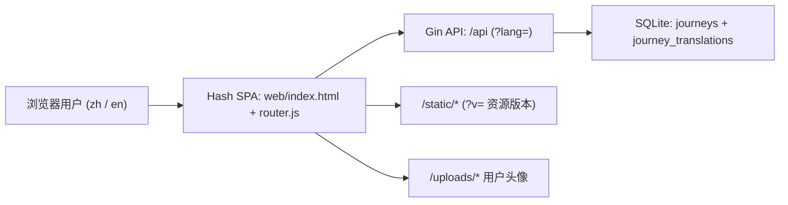
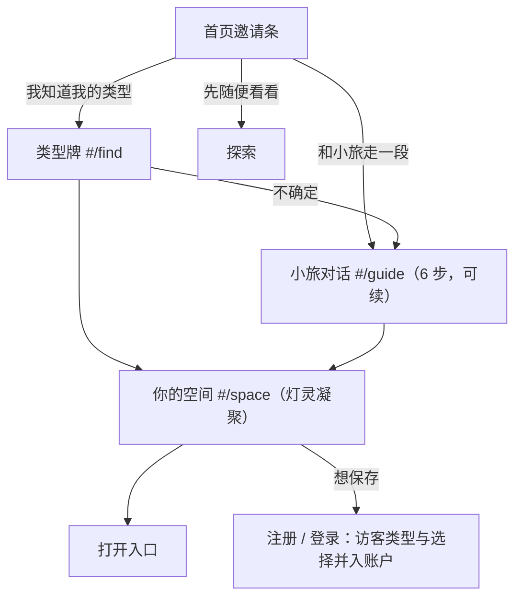
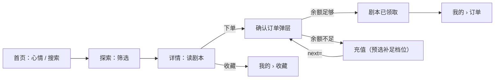
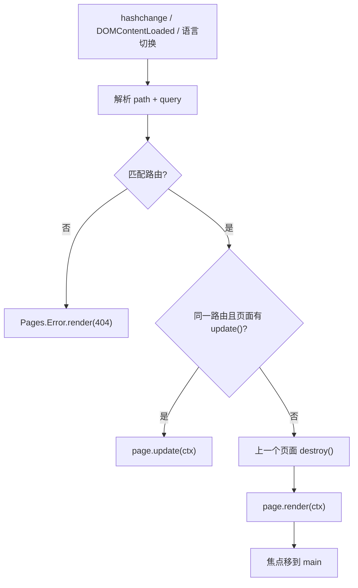
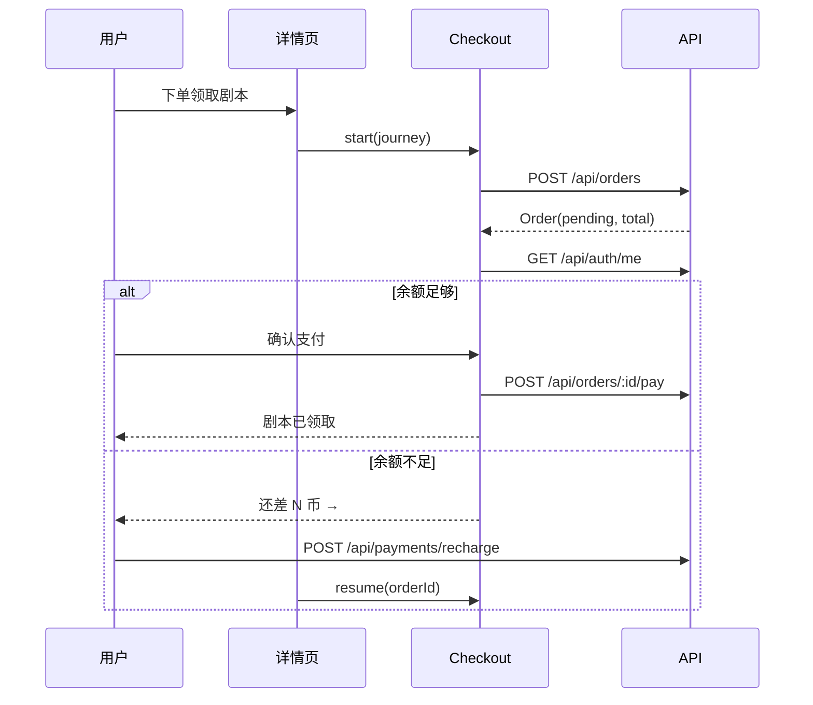

# DDD/UI 设计说明 — 100 Journeys

**标准**: IEEE 1016-2009 — Software Design Descriptions
**项目**: 100种不可思议的旅行 · Lightweight Content MVP
**版本**: v1.5 「灯笼夜游 / Lantern Night」改版（2026-10）
**源码依据**: `web/index.html`、`web/js/**`、`web/css/**`
**生成证据**: `docs/generated/frontend-routes.md`、`e2e/tests/*.spec.js`

---

## 1. 设计范围与真实边界

前端是 Vanilla HTML / CSS / JS 实现的 Hash SPA，不使用框架。Gin 服务注入 `window.APP_CONFIG`、为 CSS/JS 链接打上资源版本号并返回静态资源；页面渲染、路由、状态和接口调用都在浏览器端完成。

本次改版的目标：修复会被一眼看出的故障（探索页筛选与搜索、错误提示、手机端登录入口、半成品浅色模式），建立一套有角色规则的设计系统，并支持中英双语。

---

## 2. 设计方向 — 灯笼夜游

核心比喻：用户提着灯走进一个隐秘世界。界面是夜色，**光只落在可以操作的地方**。

### 2.1 角色规则（不得挪作他用）

| Token | 角色 | 禁止 |
|---|---|---|
| `--color-action*` 灯笼金（深色）/ 墨色（浅色） | 主操作按钮、选中态、焦点环 | 装饰底色、大面积背景 |
| `--color-mood*` 桃花粉 | 心情关键词（#孤独） | 按钮、链接、状态 |
| `--color-on-media*` | 压在照片上的文字（两套主题相同） | 普通页面正文 |
| `--font-story` 故事宋体 | 旅程标题、引言、章节标题、品牌字 | 表单、按钮、数据 |
| `--font-ui` 系统黑体 | 其余所有界面文字 | — |
| `--lumi-*` 灯灵插画色 | 只用于小旅（`lumi.js`）的插画 | 任何界面元素 |

- MBTI 代码统一为中性描边小标签，去掉原来的 16 种彩色。
- 不使用 emoji 做图标，图标统一为 `UI.icon()` 内联 SVG。
- 不加载网络字体：故事宋体通过 `@font-face local()` 只解析到真正的宋/明体（Songti、思源宋体、Noto Serif SC），找不到时回退黑体，避免 Windows 上的伪粗 SimSun；英文界面切换为拉丁优先字体栈。

### 2.2 颜色（WCAG 2.2 AA，已由 axe 扫描验证）

| 角色 | 深色（默认） | 对比度 | 浅色 | 对比度 |
|---|---|---|---|---|
| 正文 / 底 | `#f2ede4` / `#0d0f13` | 16.5:1 | `#17191e` / `#f3f3f1` | 15.8:1 |
| 次要文字 | `#b8b1a5` | 9.0:1 | `#4a4e57` | 7.5:1 |
| 弱化文字 | `#8f897f` | 5.5:1 | `#62666f` | 5.2:1 |
| 主操作 | `#1d1405` on `#f2c46d` | 11.2:1 | `#fbe1a6` on `#1a1c21` | 13.3:1 |
| 心情词 | `#f3aebd` on tint | 7.7:1 | `#a3384f` on tint | 5.8:1 |
| 焦点环 vs 底 | `#f2c46d` | 11.8:1 | `#a86a12` | 4.0:1（非文字 ≥ 3:1） |

首页与详情页的头图是照片，两套主题下都保持深色画面；浅色模式作用于其下的所有内容。

### 2.3 标志性细节

- **旅行剧本票**：详情页的预订卡做成带打孔线的票据，写着临时身份、三项指数（冒险 /10、隐秘 /10、风险 /5）与匹配人格，主按钮为「下单领取剧本」。
- **灯笼光**：旅程卡片悬停时，一团随指针移动的暖光（`--mx/--my`），呼应首页的萤火粒子。
- **小旅 · 灯灵**：向导是一团会呼吸、会眨眼的灯火（`Lumi.svg()`，代码绘制 SVG，两套主题通用）。找到类型时，光点聚拢、灯火一亮，凝成该类型的形态（`Lumi.condense()`，约 1.5 秒；减少动态效果时直接出现），之后向导窗口、空间头部都以这个形态出现。形态由固定语法生成：四组定身形（NT 晶灯 · NF 桃花灯 · SJ 纸灯 · SP 焰灯），E 放射光芒 / I 环形光圈，J 端正 / P 倾身摇晃，F 脸颊泛红，E 张口笑 / I 抿嘴笑，每型一种灯色与一件随身小物。设计稿：`docs/design/lumi/`。
- **海报式详情头图**：封面只有 720px 宽，桌面端以清晰海报展示，同图模糊放大作为背景，避免全屏拉伸发糊。

---

## 3. Context Viewpoint — 上下文视图

### 3.1 运行上下文



### 3.2 前端路由

| Hash 路由 | 页面模块 | 主要用途 |
|---|---|---|
| `#/` | `Pages.Home` | 首屏搜索、心情入口、三步说明、精选（1 大 4 小） |
| `#/explore` | `Pages.Explore` | 搜索、幻想类型主筛选、筛选面板、旅程网格 |
| `#/journey/:slug` | `Pages.Detail` | 海报头图；有入口内容时为身份、章节、岔路选择、尾声、真实与虚构；剧本票、页内下单 |
| `#/find` | `Pages.Find` | 16 张类型牌（带灯灵形态），“不确定”转交小旅 |
| `#/guide` | `Pages.Guide` | 小旅的六步情境对话，可中途离开再续上，结束时凝聚揭晓 |
| `#/space` | `Pages.Space` | 你的空间：为你打开的入口、画一个自己的入口、你带走的、收藏；访客保存提示 |
| `#/login` | `Pages.Login` | 登录，支持 `?next=` 回跳 |
| `#/register` | `Pages.Register` | 注册，字段级校验，可选头像 |
| `#/profile` | `Pages.Profile` | 身份与钱包、订单 / 收藏 / 交易记录 / 旅行人格（`?tab=`） |
| `#/recharge` | `Pages.Recharge` | 档位充值（真实赠送），`?need=&next=` 补差额后回到结账 |
| `#/admin-login` | `Pages.AdminLogin` | 管理员登录 |
| `#/admin` | `Pages.Admin` | 实时指标与分布，导出 CSV |
| `#/about` | `Pages.About` | 产品与技术说明 |
| 其他 | `Pages.Error.render(404)` | 404 + 推荐旅程 |

### 3.3 主要用户流

核心路径：到达 → 找到类型 → 进入你的空间，每一步都有下一步。





---

## 4. Composition Viewpoint — 组合视图

```text
web/index.html
├── a.skip-link            跳到正文
├── header#main-nav        nav.js：品牌、导航、语言/主题、钱包、账户菜单、手机抽屉
├── main#main-content      router.js 分发 Pages.*（tabindex=-1，路由切换后接收焦点）
├── footer#main-footer     nav.js 渲染
├── #ai-pet                ai-pet-dom.js：向导按钮 + 非模态对话框
├── #toast-region          UI.toast() 轻提示（aria-live）
└── JS
    ├── config.js / client-audit.js / i18n.js / eventbus.js
    ├── api.js             统一请求、错误对象、?lang=
    ├── ui.js              UI（图标、卡片、toast、sheet）、MBTI、Session
    ├── nav.js / checkout.js / ai-pet*.js
    ├── pages/*.js
    └── router.js          最后加载
```

### 4.1 共享组件

| 组件 | 位置 | 说明 |
|---|---|---|
| `UI.journeyCard(j)` | `ui.js` + `components/card.css` | 唯一的旅程卡片：封面 4:5、心情词、地区、标题、钩子、价格、冒险指数。探索、收藏、推荐、404 共用 |
| `.feature-card` | `components/card.css` | 首页图片主导的精选卡，`--lead` 为大卡 |
| `UI.sheet()` | `ui.js` + `components/ui.css` | 模态弹层：焦点锁定、Esc/遮罩关闭、关闭后还原焦点、离开页面自动关闭；手机为底部抽屉 |
| `UI.toast()` | `ui.js` | 轻提示，可带一个操作链接 |
| `Lumi.svg(code)` / `Lumi.condense(el, code)` | `lumi.js` + `components/lumi.css` | 小旅灯灵：无类型时为灯火，有类型时为该类型形态；凝聚动画 |
| `Guest` | `guest.js` | 访客状态（类型、岔路选择、对话进度、匿名访客 id），登录后合并进账户 |
| `Checkout` | `checkout.js` + `components/checkout.css` | 下单 → 确认支付 → 成功；余额不足给出差额并跳转充值 |
| 筛选工具栏 | `components/filter.css` | 吸顶搜索 + 幻想类型 + 筛选面板（桌面浮层 / 手机底部抽屉） |
| 按钮 / 标签 / 输入框 / 分段控件 / 标签页 / 空状态 / 骨架屏 | `components/ui.css` | 设计系统原语 |

---

## 5. Interface Viewpoint — 接口视图

### 5.1 前端配置

```js
window.APP_CONFIG = { apiBase: "/api", mediaBase: "/static/assets/images" };
```

- 由 `internal/webapp.RenderIndex` 以 JSON 编码注入（防止配置值闭合 script 标签）。
- 静态图片通过 `API.mediaUrl()` 拼接 `mediaBase`，切换 CDN 不改前端代码。
- `index.html` 中所有 CSS/JS 链接写作 `?v=__ASSET_VERSION__`，服务端替换为资源指纹（或 `ASSET_VERSION` 环境变量）。

### 5.2 API Client

| 方法 | 接口 |
|---|---|
| `getJourneys(params)` / `getJourney(slug)` | `GET /api/journeys`、`GET /api/journeys/:slug`（自动带 `lang`） |
| `getTags()` / `getCaptcha()` | `GET /api/tags`、`GET /api/captcha` |
| `register` / `login` / `me` / `uploadAvatar` | `/api/auth/*` |
| `listSaved` / `saveJourney` / `unsaveJourney` | `GET/PUT/DELETE /api/auth/saved[/:slug]` |
| `updateMBTI(code)` | `PUT /api/auth/mbti` |
| `createOrder` / `listOrders` / `getOrder` / `payOrder` | `/api/orders*` |
| `rechargeTiers` / `recharge` / `listTransactions` | `/api/payments/*` |
| `adminStats` / `adminUsers` / `adminExport` | `/api/admin/*` |

错误对象带 `status` 与 `apiError`（信封中的 `error`）；页面统一用 `I18n.error(err)` 转成可读文案，不再出现 `HTTP 401`。`/auth/*` 返回 401 时自动清除失效 token 并刷新顶栏。

### 5.3 页面契约

```text
render(ctx)   首次进入或路由参数变化
update(ctx)   同一路由仅 query 变化（探索筛选、个人页 tab）
destroy()     离开页面：清理计时器、监听器、进行中的请求序号
ctx = { path, params, query: URLSearchParams }
```

### 5.4 状态

| 状态 | 位置 |
|---|---|
| JWT | `localStorage.auth_token`（记住我）或 `sessionStorage` |
| 当前用户 | `Session`（去重的 `/auth/me` 缓存，`session:updated` 事件） |
| 语言 | `localStorage.lang`，默认按浏览器语言；`<html lang>` 同步 |
| 主题 | `localStorage.theme`，默认跟随系统；首屏前设置避免闪烁 |
| 筛选 / tab | Hash query，经 `Router.replaceQuery()` 更新（不触发重绘） |

---

## 6. Structure Viewpoint — 结构视图

### 6.1 CSS 层级

```text
web/css/
├── tokens.css        角色化颜色、字体、间距、圆角、动效、层级；深 / 浅两套
├── global.css        reset、基础元素、焦点、sr-only、跳到正文、减少动态效果
├── layout.css        container、page、grid-cards、footer（垂直间距一律 padding-block）
├── components/       ui、nav、card、hero、filter、checkout、ai-pet
└── pages/            home、explore、detail、auth、profile、recharge、admin、about、error
```

### 6.2 响应式

断点：1080（四列 → 三列）、960（详情双栏 → 单栏）、860（导航收进抽屉、登录页单栏）、760（手机：两列卡片、详情底部预订条、筛选面板变底部抽屉）。E2E 断言主要页面在 Pixel 7 宽度下无横向滚动。

---

## 7. Behavior Viewpoint — 行为视图

### 7.1 路由



### 7.2 探索页数据加载

筛选变化 → `replaceQuery` → 同步 UI → `_load(reset)`。每次请求递增序号，旧响应直接丢弃；离开页面时序号失效。这修复了旧实现中「改 hash → 整页重建 → 旧请求写入已被替换的网格 → 永远停在骨架屏」的竞态。

### 7.3 下单



---

## 8. 无障碍

- 每页一个 `h1`；跳到正文链接；路由切换后焦点移到 `main`。
- 所有控件是真正的 `button` / `a`；向导入口有 `aria-expanded`；账户菜单 Esc 关闭并还原焦点；弹层锁定焦点。
- 表单字段有 `label`，错误通过 `aria-invalid` + `aria-describedby` 关联，提交时焦点移到第一个错误。
- 充值档位是 `role=radiogroup`，支持方向键。
- `prefers-reduced-motion`：不启动粒子，动画降为 1ms。
- `e2e/tests/a11y.spec.js` 在深浅两套主题下对 7 个页面运行 axe（WCAG 2.1 A/AA），违规即失败。

---

## 9. 风险与边界

| 项 | 说明 |
|---|---|
| AI 向导 | 前端规则引擎，非外部大模型；文案标注「规则引擎」 |
| 双语内容 | 旅程内容由 `journey_translations` 提供；订单与统计中的标题是基础语言快照，前端按 id/slug 显示当前语言 |
| 照片头图 | 两套主题下都是深色画面，属于有意设计 |
| 静态缓存 | `/static` 长期 immutable 缓存依赖 `?v=` 版本号；新增或替换资源请使用新文件名或经由 `index.html` 引用 |

---

## 10. DDD 合规检查

| IEEE 1016 视图 | 位置 | 状态 |
|---|---|---|
| Context | 第 3 节 | 已覆盖 |
| Composition | 第 4 节 | 已覆盖 |
| Interface | 第 5 节 | 已覆盖 |
| Structure | 第 6 节 | 已覆盖 |
| Behavior | 第 7 节 | 已覆盖 |
| Design rationale | 第 2、9 节 | 已覆盖 |
